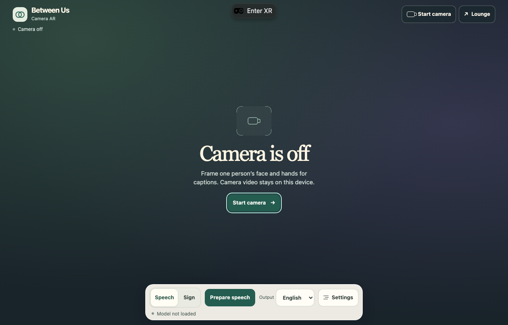
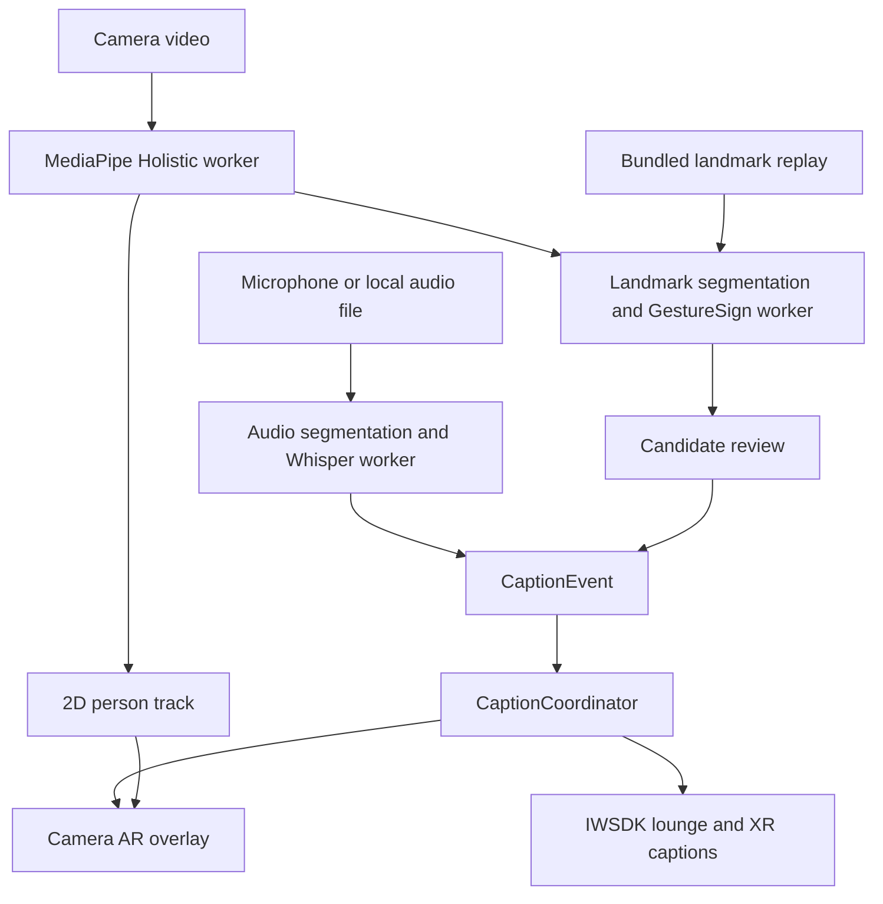
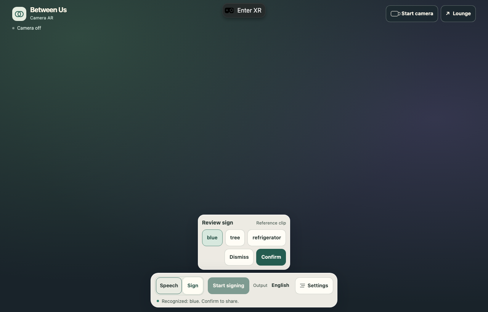

# Between Us

Between Us is a browser-based mixed-reality captioning prototype built with Meta IWSDK. It runs Whisper speech transcription and translation and GestureSign isolated American Sign Language (ASL) classification on the device. Both engines emit typed caption events that can follow a person in Camera AR or attach to a scene avatar in the lounge.



## Run locally

Use Node.js 22.12.0 from `.nvmrc` or another version supported by `package.json`.

```sh
git clone https://github.com/mridul12-cat/Between-Us.git
cd Between-Us
npm ci
npm run dev
```

Open the URL printed by the IWSDK CLI, usually `https://localhost:8081/`. The CLI manages the HTTPS development server and opens a Chromium runtime window. First launch may download Chromium. Camera and microphone access require a secure context and browser and system permission. The app opens in Camera AR with both devices off.

## Architecture



### Speech inference

An `AudioWorklet` mixes microphone channels into mono `Float32Array` batches. An RMS threshold and silence window split capture into utterances, with a live segment cutoff at approximately six seconds. The session allows one active inference and one pending segment. It drops additional segments when both slots are occupied. The worker resamples native-rate audio to **16 kHz mono** with an anti-aliasing filter before inference.

The worker uses Transformers.js with quantized `Xenova/whisper-base` by default, plus a Tiny option. CPU inference uses ONNX Runtime Web with single-threaded WebAssembly. The lounge also exposes WebGPU and automatic backend selection. Original-language output uses Whisper’s `transcribe` task. English output uses `translate` unless the input is explicitly English. Auto input records the source language as `und` because the worker does not expose a verified detection result. A locally selected audio file follows the same inference path with `recorded-sample` provenance. [Speech implementation](src/speech/)

### ASL inference

A MediaPipe Holistic worker extracts hand, pose, and face landmarks. It processes one video frame at a time, skips frames while busy, and passes timestamps downstream. In Camera AR, person tracking and ASL recognition share this worker. The live recognizer segments hand motion and uses actual frame timestamps to resample to the model’s **30 fps** feature clock. A gap over **250 ms** interrupts an open segment.

The bundled GestureSign checkpoint `default-2fc9038cc4` accepts an unpadded `float32` tensor of shape `[1, T, 460]` with **8–64 model frames**. A separate ONNX Runtime Web worker returns logits for **250 isolated ASL signs** and a **128-dimensional embedding**. The app keeps the model’s candidate ranking. Live proposals below a 0.50 top score or with less than a 0.15 lead over the next candidate require review, along with proposals already flagged by the model’s decision rules or framing checks. Uncertain results always require explicit confirmation. [Sign implementation](src/sign/) · [Pinned model metadata](public/sign/models/model-meta.json)

### Caption routing and placement

`CaptionEvent` carries modality, language, status, source provenance, and inference metadata. `CaptionCoordinator` validates the event, handles stale revisions, routes it to a known anchor or the neutral area, and retains up to **24 history entries** in memory.

Camera AR records the active track when a speech segment is queued or a sign starts. A delivered result attaches only if the same track is still eligible. Delivered results without a matching track appear in the neutral area. Placement projects normalized head bounds into the actual video rectangle after letterboxing and mirroring. Captions and live sign review cards prefer space above the head and fall back when the available space is too small. The lounge renders through UIKitML and the IWSDK scene declared by `iwsdk.config.json`. [Caption coordinator](src/captions/coordinator.ts) · [Camera AR viewport](src/ar/viewport.ts) · [Architecture notes](docs/ARCHITECTURE.md)

## Camera AR controls

- **Start camera** opens the preview. Frame one person, then leave **Settings → Follow person** enabled to attach new captions automatically.
- **Speech** uses **Prepare speech** to load the model and **Start listening** to request the microphone. **Settings → Use audio file** accepts a short recording when the model is ready.
- **Sign** uses the active camera. Select **Start signing**, make one sign, then confirm or dismiss the candidate.
- **Settings** contains camera selection, mirroring, fullscreen, input language, caption size, contrast, reduced motion, history, and sign diagnostics.
- **Lounge** opens the guided demo and the authored spatial interface, including IWSDK’s browser-based XR emulator.


### Camera-free sign review

In the lounge, select **Sign → Try reference clip** to run a bundled landmark sequence through the actual ONNX classifier. The development screenshot below shows the reference candidates in Camera AR with capture off.



## Build, verify, and deploy

| Command | Purpose |
| --- | --- |
| `npm run typecheck` | Check the TypeScript sources. |
| `npm test` | Run Vitest coverage for caption routing, camera projection, audio segmentation, worker contracts, and sign timing and review policy. |
| `npm run build` | Verify the byte sizes and SHA-256 digests of the bundled sign assets, then build into `dist/`. |
| `npm run preview` | Serve the production output locally for a browser smoke test. |
| `npm run sign:assets` | Restore the version-pinned sign runtime assets. |
| `npm run dev:down` | Stop the IWSDK-managed development server. |

Vercel imports the repository root with `main` as the production branch. [`vercel.json`](vercel.json) selects Vite, runs `npm ci --include=dev` and `npm run build`, and serves `dist/`. Select Node.js 24.x in the Vercel project settings. The build requires no environment variables or server functions. Open the deployment URL directly over HTTPS for media permissions.

## Privacy and limitations

Camera and microphone capture start through separate, explicit controls. Leaving Camera AR or hiding the document stops capture. Session generation checks discard late results after a stop or mode change. The app holds captions in session memory and uses no persistent media recorder. Whisper weights download from public model hosts and may be cached by the browser. The MediaPipe SDK can make a small telemetry request. Recognition does not require an inference API key or server.

Camera AR uses 2D image coordinates and a single active track. It has no identity recognition, voice-to-face matching, or diarization. GestureSign classifies isolated signs from its fixed vocabulary. Its classifier scores and review thresholds are not guarantees of live accuracy. The bundled reference verifies the inference path, while live signing accuracy and physical Quest behavior remain unverified. The app has no offline service worker.

[Contributor guide](AGENTS.md)

## License

Between Us is released under the [MIT License](LICENSE). Bundled third-party software, models, and data retain their own terms. See [third-party notices and attribution](docs/THIRD_PARTY_MODELS.md).
