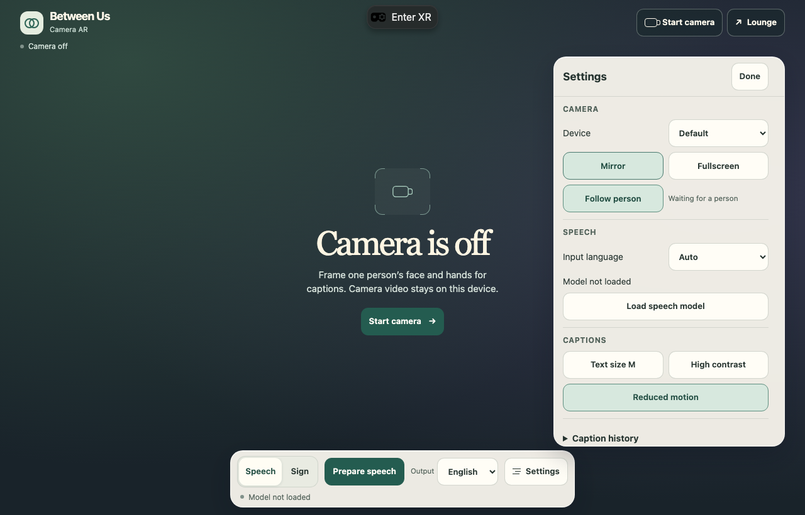

# Between Us

Between Us is a mixed-reality captioning prototype built with Meta IWSDK. It runs Whisper speech transcription and translation and GestureSign isolated ASL recognition in browser workers on the device. Recognition requires no inference API key or subscription.


## Run locally

Use Node.js 22.12.0 from `.nvmrc`, or another version supported by `package.json`, then run:

```sh
git clone https://github.com/mridul12-cat/Between-Us.git
cd Between-Us
npm ci
npm run dev
```

Open the URL printed by the IWSDK CLI, usually `https://localhost:8081/`. The managed browser uses a local HTTPS certificate for camera and microphone access. First launch may download Chromium. Grant site and system permissions when prompted for a device.

```sh
npm run typecheck
npm test
npm run build
npm run dev:down
```

The production build is in `dist/`. Serve it over HTTPS to use camera and microphone capture outside localhost. The pinned GestureSign classifier, MediaPipe task, runtime files and landmark replays are included in the repository. Use `npm run sign:assets` to restore or verify the bundled runtime files.

## Deploy to Vercel

Import the GitHub repository into Vercel and select `main` as the production branch. The project root is the repository root. The committed `vercel.json` selects Vite, installs the locked build dependencies, runs `npm run build`, and serves `dist/`. Use Node.js 24.x in the Vercel project settings. The app requires no environment variables or server functions.

Open the deployment URL directly over HTTPS to grant camera or microphone access. Camera AR opens with capture off, and Whisper downloads its model files on first use. You can exercise the bundled ASL inference through **Lounge → Sign → Try reference clip** without granting camera access.

## Camera AR

Camera AR opens first. Camera and microphone capture start only when explicitly requested.



- **Start camera** shows the camera preview. Frame one person and new captions will follow them automatically. Toggle **Settings → Follow person** to place new captions in the neutral area.
- **Speech** offers transcription in the original language or translation to English. Choose **Prepare speech**, then **Start listening**. Whisper downloads model files on first use. **Settings → Use audio file** accepts a short recording after the model is ready.
- **Sign** produces English candidates for isolated ASL signs. Start the camera, choose **Start signing**, and review or dismiss candidates. Uncertain results always require confirmation.
- **Settings** contains camera selection, mirroring, fullscreen, input language, caption size, contrast, reduced motion, caption history and sign diagnostics.
- **Lounge** opens the guided demo and the spatial controls. The lounge offers an explicitly labeled **Try reference clip** action in Sign mode and supports IWSDK’s browser-based XR emulator.

Camera AR associates captions with the tracked person using 2D camera coordinates. It does not identify people, match voices to faces, or interpret continuous ASL. The prototype can miss signs or produce incorrect candidates. Live signing accuracy and physical Quest behavior are unverified.

Inference runs locally. Whisper assets download from public model hosts. The MediaPipe SDK can make a small telemetry request. Caption history is held in session memory.

### Camera-free sign review

This development screenshot shows the bundled ASL reference clip classified locally and presented for confirmation. The camera and microphone were off.


[Architecture](docs/ARCHITECTURE.md) · [Contributor guide](AGENTS.md)

## License

Between Us is released under the [MIT License](LICENSE). Bundled third-party software, models, and data retain their own terms. See [third-party notices and attribution](docs/THIRD_PARTY_MODELS.md).
